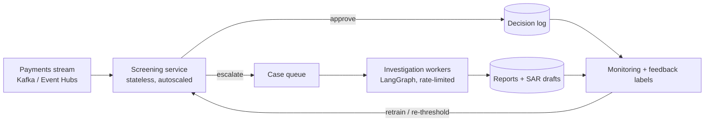

# From notebooks to service

Both projects started in notebooks: `notebooks/investigator_ai_enhanced_notebook.ipynb` here and `guardian-ai.ipynb` in GuardianAI. InvestigatorAI had already moved most of its logic into `api/`. GuardianAI's API was a stub that returned a placeholder. This is what was done to make one runnable service, and what production would still need.

## Done in this repo

| Notebook habit | Service version |
|---|---|
| Agents defined in cells with a global `fraud_df` | `api/guardian/engine.py`: agents take the reference data as a constructor argument, so they're testable with any DataFrame |
| SentenceTransformer embeddings + in-memory Qdrant for "similar transactions" | scikit-learn `NearestNeighbors` over one-hot + scaled features. Same signal, about 1 ms, no model download |
| Threshold hard-coded at 0.7 (flags about 11% of fraud) | `GUARDIAN_FRAUD_THRESHOLD`, default 0.3 after a threshold sweep (see README) |
| Accuracy printed on 10 random rows | `GET /screen/metrics` returns accuracy, precision, recall, FPR and latency |
| API crashes if keys are missing | Screening-only mode. LLM routes return 503 until keys are configured |
| `pip install .` with an out-of-date lock | `uv sync --frozen` from a refreshed `uv.lock` |

## What production would still need

1. **Real data.** Replace the 5,000 synthetic rows with labelled historical transactions. Fit the IsolationForest and the neighbour index offline, version them as artifacts, and load them at startup.
2. **Customer history features.** The Behavioral Agent compares against the whole population. Per-customer velocity and spend baselines (from a feature store or Redis) are the biggest accuracy gain available.
3. **Out-of-sample evaluation.** Use a time-based split, report precision and recall at the operating threshold, and track them per week.
4. **Async hand-off.** Escalations should go to a queue (for example SQS or a Redis stream) and be processed by investigation workers, instead of an analyst clicking through.
5. **LLM cost and latency control.** Cache regulatory retrieval, cap tokens per case, and keep LangSmith traces per investigation for audit.
6. **Vector store lifecycle.** Run `init-docs` as a CI job when `data/pdf_downloads/` changes (the existing `update-vector-database` workflow does this for Qdrant Cloud).
7. **Feedback loop.** Analyst decisions on escalated cases become labels to re-tune the threshold and the agent weights.
8. **Out of scope here:** authentication, PII handling, rate limiting beyond the existing simple limiter, and model risk-management documentation.
