# InvestigatorAI + GuardianAI: Screen in milliseconds, investigate in minutes

<p align="center"></p>

<p align="center"></p>

> One local stack for the whole fraud workflow. **GuardianAI** screening (folded in from [ovokpus/GuardianAI](https://github.com/ovokpus/GuardianAI)) scores every transaction in about 10 ms with four lightweight agents and no LLM call. Anything risky is escalated, with the form already filled in, to **InvestigatorAI**'s LangGraph multi-agent investigation: regulatory RAG, web and academic research, compliance checks and a SAR-ready report.

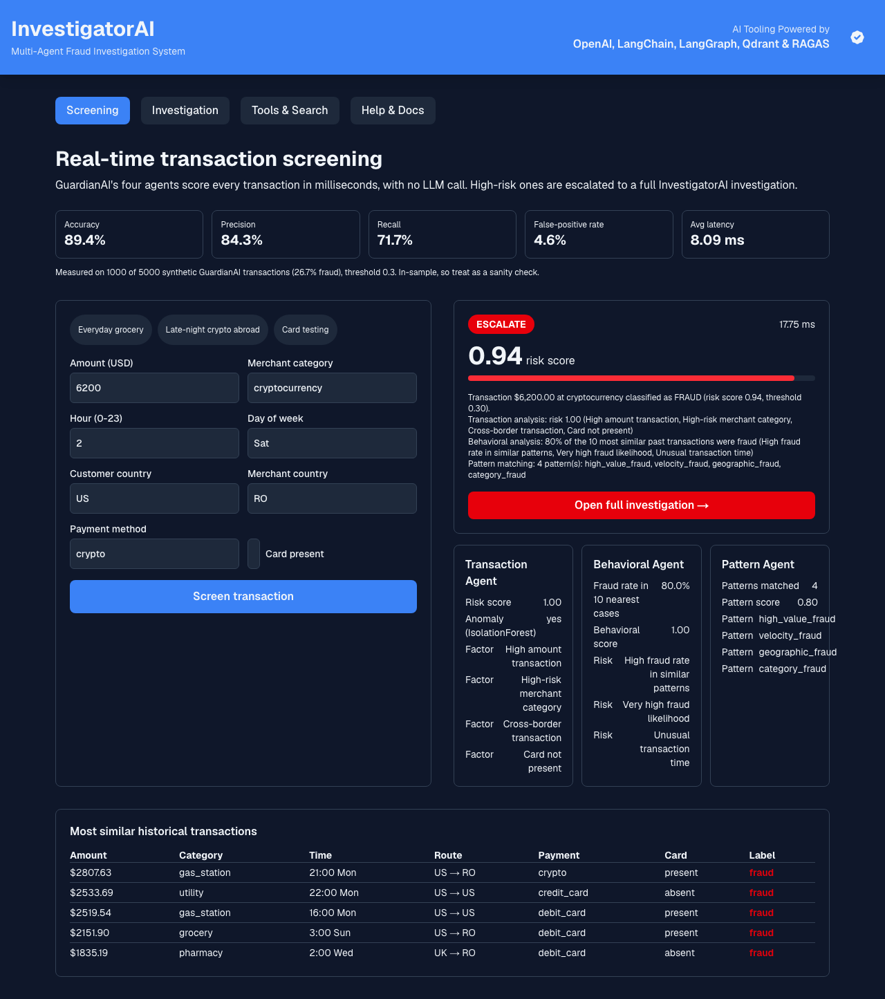

---

## Business case

Fraud and anti-money-laundering teams spend much of their time assembling evidence before an analyst can decide whether to file a suspicious activity report. InvestigatorAI screens each transaction with a fast machine-learning check, then hands the cases worth a closer look to LangGraph agents that gather regulatory guidance, risk signals and a draft report for human review. The analyst keeps the decision, and the system does the assembly. [docs/BUSINESS_CASE.md](docs/BUSINESS_CASE.md) covers the buyer, use cases, a sourced cost baseline and an illustrative ROI model.

## 1. The problem

Fraud teams have two jobs that pull in opposite directions:

| Job | Needs | Typical pain |
|---|---|---|
| **Screening**: is this payment risky *right now*? | Millisecond latency, explainable, cheap per call | Rule engines with 10–15% false positives |
| **Investigation**: what is actually going on, and do we file a SAR? | Deep research, regulations, evidence, a written report | About 6 hours of manual analyst work per case |

Running an LLM on every payment is too slow and too expensive. Rules alone can't write a report. This repo puts both stages in one app, with a hand-off between them.

## 2. The flow

<p align="center"></p>

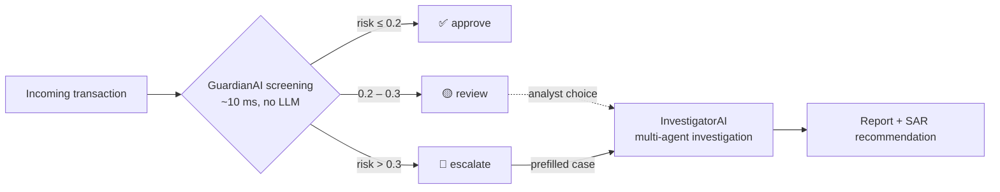

### Stage 1: GuardianAI screening (`api/guardian/`)

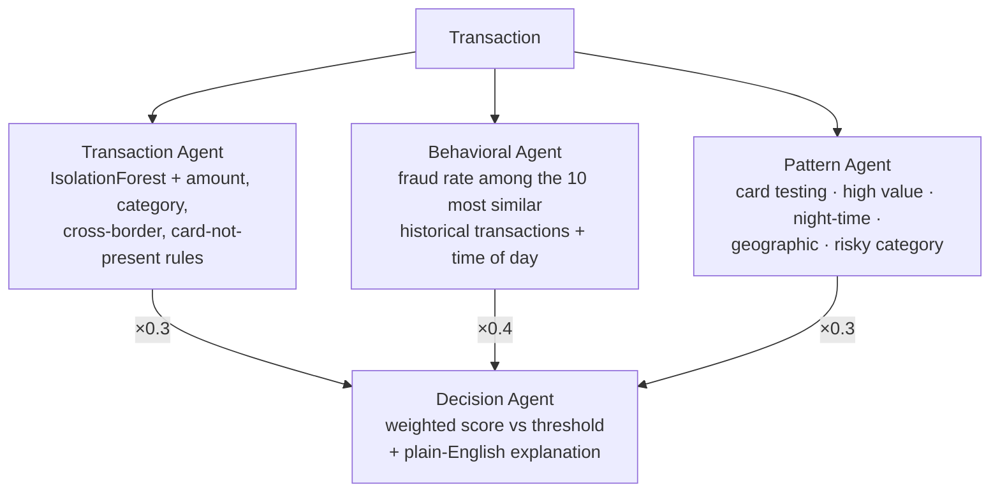

On the bundled 5,000-transaction synthetic dataset (26.7% fraud), measured on a 1,000-row sample at threshold 0.3: **89.4% accuracy, 84.3% precision, 71.7% recall, 4.6% false-positive rate, about 8 ms per transaction.** These numbers are in-sample: each row's neighbours exclude the row itself, but the labels come from the same data. Treat them as a sanity check, not a benchmark.

| Threshold | Accuracy | Precision | Recall | FPR |
|---:|---:|---:|---:|---:|
| **0.3** (default) | 87.8% | 82.8% | 68.7% | 5.2% |
| 0.5 | 81.0% | 90.7% | 32.2% | 1.2% |
| 0.7 (GuardianAI notebook) | 76.1% | 99.3% | 10.6% | 0.03% |

*(Full 5,000-row run. Set `GUARDIAN_FRAUD_THRESHOLD` in `.env` to trade recall for precision.)*

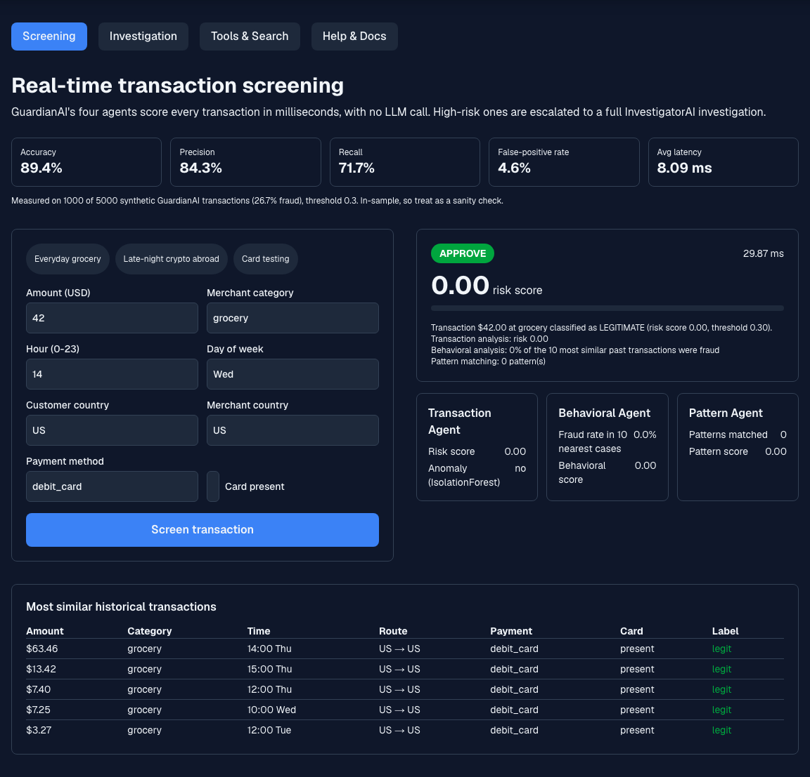

### Stage 2: InvestigatorAI investigation (`api/agents/`)

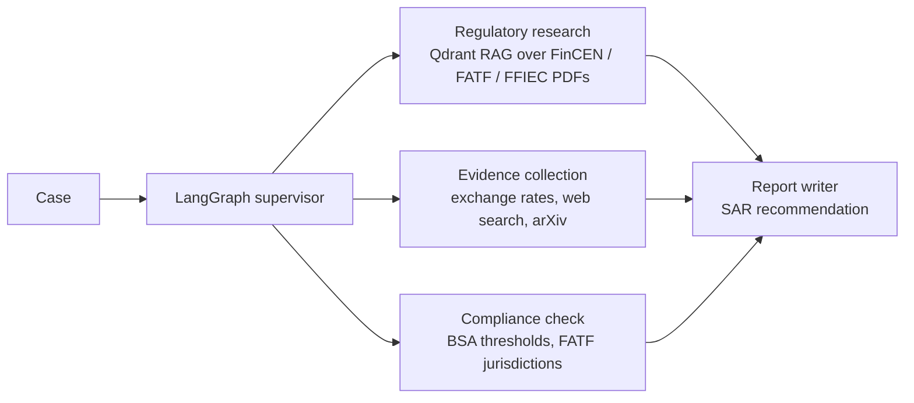

**Escalate** opens the investigation form pre-filled with the amount, destination country, risk rating and a description of why the transaction was flagged:

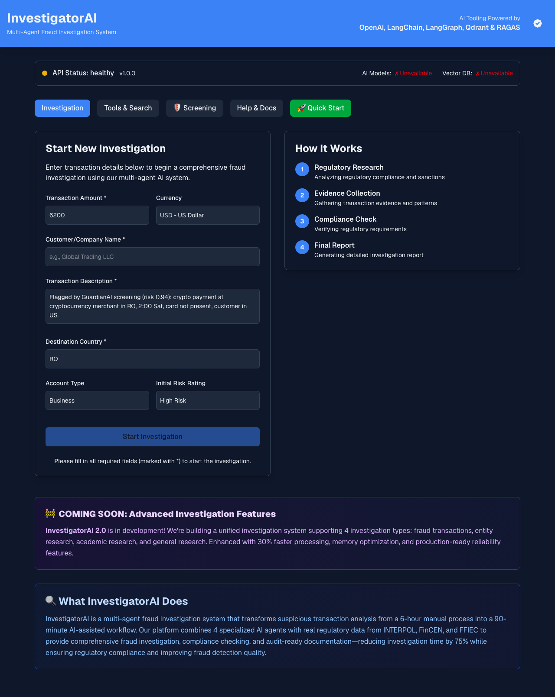

> **About this screenshot:** it was taken with **no `OPENAI_API_KEY`**. The status bar honestly shows *AI Models ✗ Unavailable* and *Vector DB ✗ Unavailable*, and `POST /investigate` returns `503`. No investigation output is shown here, because none was produced. Add keys to `.env` to run real investigations.

## 3. Architecture

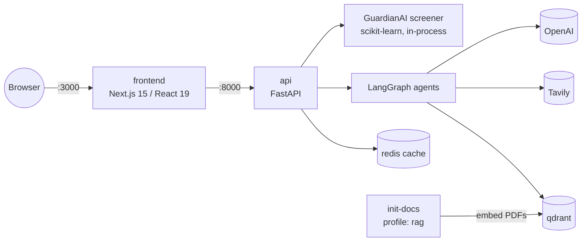

| Mode | What you need | What works |
|---|---|---|
| **Screening-only** (default) | nothing | `/screen*`, `/exchange-rate`, `/health`, the whole Screening page |
| **Full** | `OPENAI_API_KEY` (+ `TAVILY_SEARCH_API_KEY` for web search), then load the docs once | Everything above, plus `/investigate*`, `/research/*` and `/search` |

### Endpoints added by the GuardianAI merge

| Endpoint | Purpose |
|---|---|
| `POST /screen` | Score a transaction: risk score, `approve` / `review` / `escalate`, per-agent outputs, explanation |
| `POST /screen/similar` | Nearest historical transactions to a hypothetical one |
| `GET /screen/similar/{transaction_id}` | Nearest neighbours of a reference transaction |
| `GET /screen/metrics?samples=` | Accuracy, precision, recall, FPR and latency on the bundled data |
| `GET /screen/samples?fraud=` | Example transactions |
| `GET /screen/options` | Valid categories, countries and payment methods |

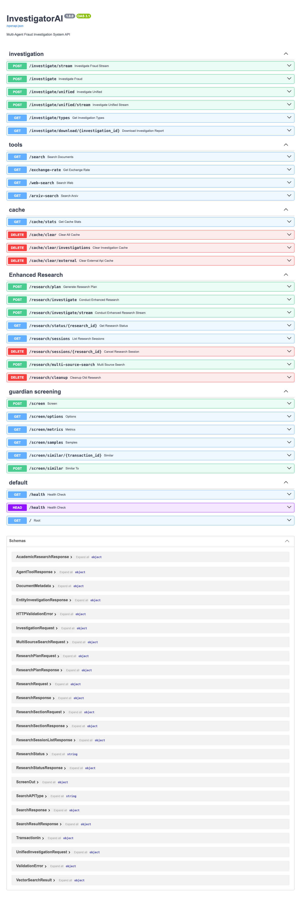

## 4. Run it

```bash
cp .env.example .env           # leave keys empty for screening-only mode
docker compose up --build      # frontend :3000, api :8000, qdrant :6333, redis
open http://localhost:3000/screening

# With an OpenAI key in .env, load the regulatory PDFs into Qdrant once:
docker compose --profile rag run --rm init-docs
docker compose restart api

docker compose down            # add -v to drop the qdrant/redis volumes
```

Local development:

```bash
uv sync --extra dev
uv run pytest                                 # guardian + API smoke tests (no keys needed)
uv run uvicorn api.main:app --reload          # :8000
cd frontend && npm ci && npm run dev          # :3000
```

Screenshots are regenerated from the running stack with `uv run --no-project --with playwright python scripts/screenshots.py`.

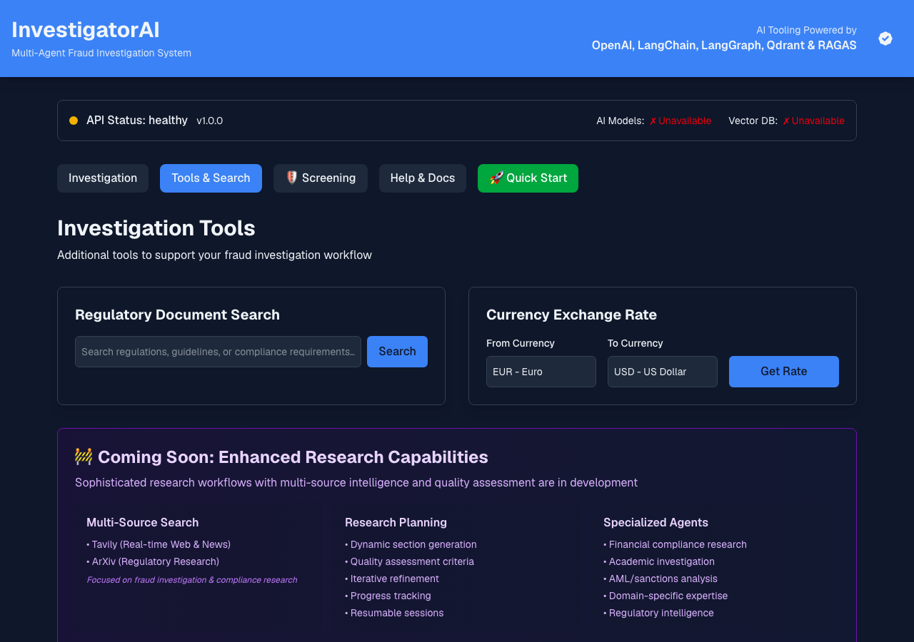

## 5. Repo map

```
api/guardian/        GuardianAI screening engine + /screen router (new)
api/agents/          LangGraph multi-agent investigation + research agents
api/endpoints/       investigation, research, tools, cache routers
api/services/        vector store, external APIs, cache, unified investigation
frontend/            Next.js app (new /screening page; investigation form accepts prefill params)
data/guardian/       5,000 synthetic labelled transactions from GuardianAI
data/configs, data/pdf_downloads   exchange rates, FATF lists, regulatory PDFs for RAG
rag/                 vector DB initialisation (init-docs service)
notebooks/           original research and evaluation notebooks
docs/                business case, demo guide, original README
legacy/              superseded files (old compose, env template, main_old.py, sample report, MERGE.md)
```

## 6. What changed in this PR

- **GuardianAI folded in.** The four-agent screener was ported from the GuardianAI notebook, whose own API was a placeholder. The one substitution: similar-transaction search uses scikit-learn nearest neighbours instead of SentenceTransformer + in-memory Qdrant. It's the same signal, with no model download and no key.
- **The API starts without keys** (screening-only mode) instead of crashing at startup. Only `OPENAI_API_KEY` is required for LLM features now; Tavily is optional.
- **Compose fixed:** the init-docs Dockerfile path was wrong, the frontend image needed `output: 'standalone'`, and local Qdrant is wired in. The image installs from `uv.lock`.
- **CI** runs pytest, then `docker compose build`. Notebook-only dependencies moved to the existing `[notebook]` extra.

See [PRODUCTIONIZING.md](PRODUCTIONIZING.md) for the path from the notebooks to a production service. No auth or security hardening is included in this local build.
